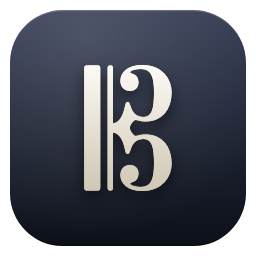
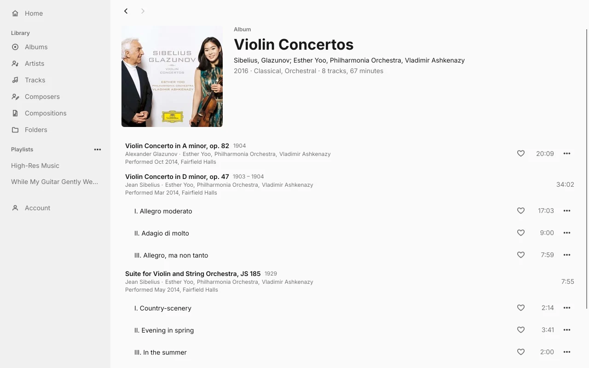
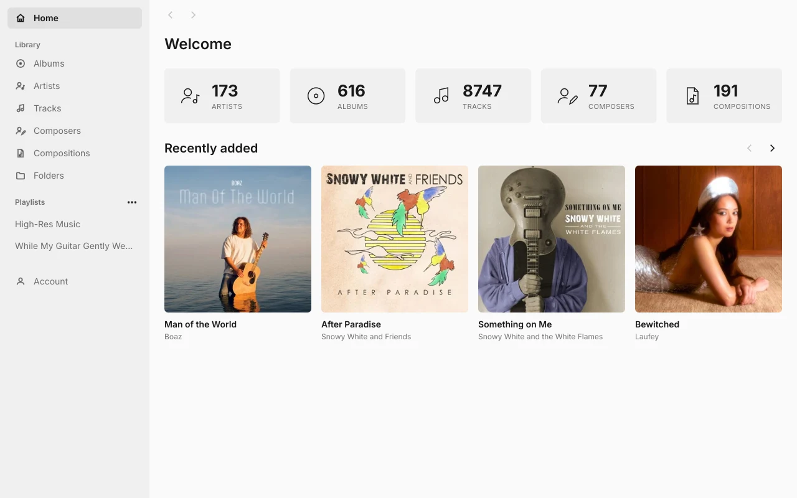
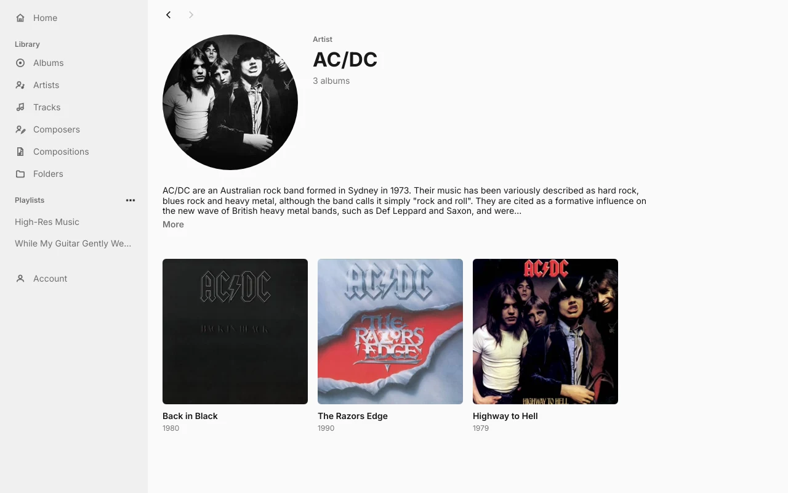
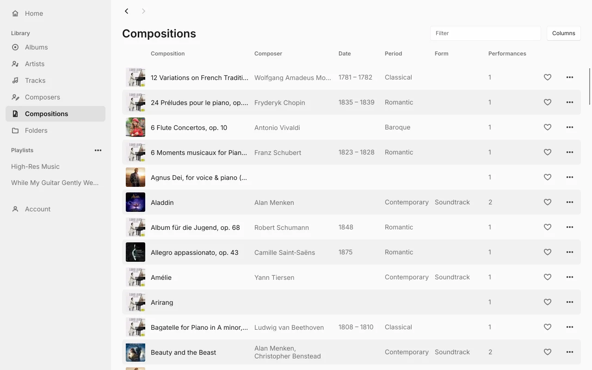
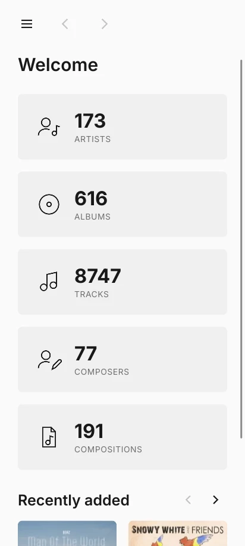
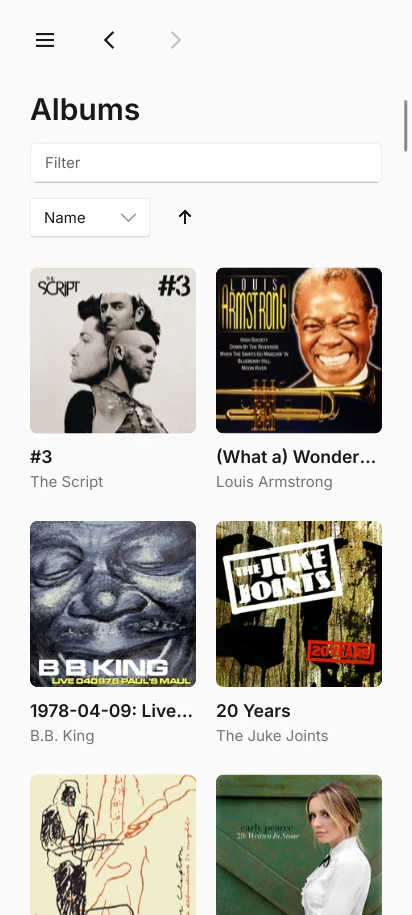
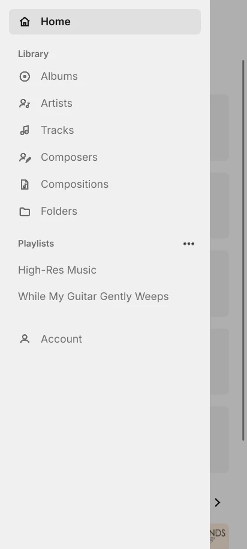

<p align="center">
  
</p>

<h1 align="center">Fonoteca Client</h1>

<p align="center">
  <strong>A music player for Fonoteca and other OpenSubsonic servers, for Android, Linux and macOS.</strong>
</p>

<p align="center">
  Browse your library the way Roon does: every name leads somewhere, from an
  album to its performers, from a composer to their works, and back.
</p>

<p align="center">
  <a href="https://github.com/schotman-development/fonoteca-client/releases/tag/edge"></a>
  <a href="https://github.com/schotman-development/fonoteca-client/actions/workflows/rolling-release.yml"></a>
  
  
  <a href="LICENSE"></a>
</p>

<p align="center">
  <a href="#features">Features</a> ·
  <a href="#install">Install</a> ·
  <a href="#servers">Servers</a> ·
  <a href="#development">Development</a> ·
  <a href="#roadmap">Roadmap</a> ·
  <a href="CONTRIBUTING.md">Contributing</a>
</p>

---

> [!NOTE]
> Early development. The app browses and organizes your library. It plays
> music on Linux so far; Android and macOS follow.

<p align="center">
  <picture>
    <source media="(prefers-color-scheme: dark)" srcset="docs/screenshots/desktop-album-dark.webp">
    
  </picture>
  <picture>
    <source media="(prefers-color-scheme: dark)" srcset="docs/screenshots/desktop-home-dark.webp">
    
  </picture>
  <picture>
    <source media="(prefers-color-scheme: dark)" srcset="docs/screenshots/desktop-artist-dark.webp">
    
  </picture>
  <picture>
    <source media="(prefers-color-scheme: dark)" srcset="docs/screenshots/desktop-compositions-dark.webp">
    
  </picture>
</p>

<p align="center">
  <picture>
    <source media="(prefers-color-scheme: dark)" srcset="docs/screenshots/phone-home-dark.webp">
    
  </picture>
  <picture>
    <source media="(prefers-color-scheme: dark)" srcset="docs/screenshots/phone-albums-dark.webp">
    
  </picture>
  <picture>
    <source media="(prefers-color-scheme: dark)" srcset="docs/screenshots/phone-drawer-dark.webp">
    
  </picture>
</p>

## Features

- **Your whole library.** Albums, artists, tracks, composers, compositions,
  folders and playlists, with a filter on the long lists and a choice of
  columns on the tables.
- **Classical music done right.** On an album, the tracks of one work sit under
  its title, composer, performers and recording. Composers and compositions get
  pages of their own on servers that offer them, such as Fonoteca.
- **Everything the server knows.** Artist biographies, similar artists and top
  tracks, album notes, and a page per track with its details.
- **Playlists.** Create, rename, delete and fill them. Pick several albums or
  tracks, with a right-click or a Shift-click for a range, and add them in one go.
- **Favourites.** A heart on every track, composition and folder stars it on the server.
- **Library scans.** Start a scan of the server's libraries from the settings
  page and follow its progress.
- **Moving covers.** On Fonoteca, albums with an animated cover play it on the
  album page.
- **Light and dark**, following the system, and a layout that works on a phone
  as well as on a wide screen.
- **Private.** Sign in with an API key or a username and password. Credentials
  live only in the system's secret store: the Keychain on macOS, the Secret
  Service on Linux, and on Android the app's own storage, encrypted with a key
  in the Android Keystore. No telemetry, no accounts, no ads.

## Install

### Android

<a href="https://apps.obtainium.imranr.dev/redirect?r=obtainium://app/%7B%22id%22%3A%22io.github.schotman_development.fonoteca.dev%22%2C%22url%22%3A%22https%3A%2F%2Fgithub.com%2Fschotman-development%2Ffonoteca-client%22%2C%22author%22%3A%22schotman-development%22%2C%22name%22%3A%22Fonoteca%20Dev%22%2C%22additionalSettings%22%3A%22%7B%5C%22includePrereleases%5C%22%3Atrue%2C%5C%22releaseTitleAsVersion%5C%22%3Atrue%7D%22%7D"></a>

Every push to `main` builds a new APK into the
[edge pre-release](https://github.com/schotman-development/fonoteca-client/releases/tag/edge).
[Obtainium](https://github.com/ImranR98/Obtainium) keeps it up to date: the
button above adds the app with pre-releases on and the release title as its
version. You can also download the APK from the release page.

Edge builds install as **Fonoteca Dev**, beside a later stable release. They
run on Android 9 or newer, on 64-bit ARM, and need no Google Play Services.
Check the signing certificate's SHA-256 fingerprint before the first install,
for example with `apksigner verify --print-certs` or in Obtainium:

```
89:63:60:B9:D3:4D:2B:0D:14:B6:02:3D:4B:4E:B5:2F:D3:74:16:33:8C:27:66:AF:C9:D7:93:BB:F0:DA:57:03
```

### Linux and macOS

There are no packages yet. Build from source with Rust (see
[Development](#development)):

```sh
cargo run --release
```

With Nix, `nix run github:schotman-development/fonoteca-client` builds and
starts it on Linux.

On Linux, saving the sign-in needs a Secret Service, such as GNOME Keyring,
KWallet or KeePassXC. Without one, you sign in again on every start.

## Servers

Any server that speaks the [OpenSubsonic API](https://opensubsonic.netlify.app)
or the older Subsonic API. The app is tested against
[Fonoteca](https://github.com/schotman-development/fonoteca) and
[Navidrome](https://www.navidrome.org). On Android, the server's address must
use https.

The app asks the server which OpenSubsonic extensions it supports and uses
those it knows. On Fonoteca, that adds composers, compositions and moving
covers.

## Development

Install Rust with [rustup](https://rustup.rs); `rust-toolchain.toml` picks the
toolchain. On Linux, Slint also needs `pkg-config` and fontconfig's development
files (`libfontconfig-dev` on Debian and Ubuntu), and playback needs FFmpeg (built
and tested with 7.1), ALSA and clang (`libavcodec-dev libavformat-dev libavfilter-dev
libavutil-dev libswresample-dev libasound2-dev libclang-dev`).

```sh
cargo run
cargo test
cargo clippy --all-targets
```

The UI also runs in a browser. This builds it with [Trunk](https://trunkrs.dev)
in a container and serves it on http://localhost:8090, rebuilding and reloading
the page on every change:

```sh
podman compose up -d
```

A browser has no secret store, so the browser build keeps the sign-in
unencrypted in the page's localStorage until you sign out. Use it with a test
account.

The same command serves the component workbench on http://localhost:8091. It
shows each shared part of the UI on its own, with sample data and switches for
long text, missing artwork and light or dark mode. It also runs natively:

```sh
cargo run --bin workbench
```

The repository holds these crates:

| Crate | What it is |
| --- | --- |
| [`fonoteca-client`](crates/fonoteca-client) | The app: Slint UI in `ui/`, Rust in `src/` |
| [`opensubsonic`](crates/opensubsonic) | An async client for the OpenSubsonic API, checked against the spec's own examples |
| [`listenbrainz`](crates/listenbrainz) | A client for ListenBrainz; the app only checks a user token with it so far |
| [`playback`](crates/playback) | The audio player: FFmpeg decodes, the sound device plays each track in its own format where it can |

The Android app is built by [`.github/workflows/rolling-release.yml`](.github/workflows/rolling-release.yml)
and packaged by Gradle in [`android/`](android).

## Roadmap

- **Playback.**
- **Scrobbling** to ListenBrainz.
- **The whole OpenSubsonic API** and every extension the server announces, not
  only the Subsonic subset most players stop at.
- **Packages:** an AppImage for Linux, an unsigned app for macOS, and stable
  Android releases.

## Contributing

Bug reports, ideas and pull requests are welcome. See
[CONTRIBUTING.md](CONTRIBUTING.md) for how to build, test and send a change,
and [SECURITY.md](SECURITY.md) for reporting a vulnerability privately.

## License

The code is [MIT](LICENSE) licensed.

<a href="https://slint.dev"></a>

Slint is used under the
[Slint Royalty-free Desktop, Mobile, and Web Applications License](https://github.com/slint-ui/slint/blob/master/LICENSES/LicenseRef-Slint-Royalty-free-2.0.md),
which asks for the badge above. The JSON examples in
`crates/opensubsonic/spec-examples` come from the
[OpenSubsonic API docs](https://github.com/opensubsonic/open-subsonic-api) and
keep their [Apache-2.0](crates/opensubsonic/spec-examples/LICENSE) license. The
Obtainium badge comes from [Obtainium](https://github.com/ImranR98/Obtainium).
